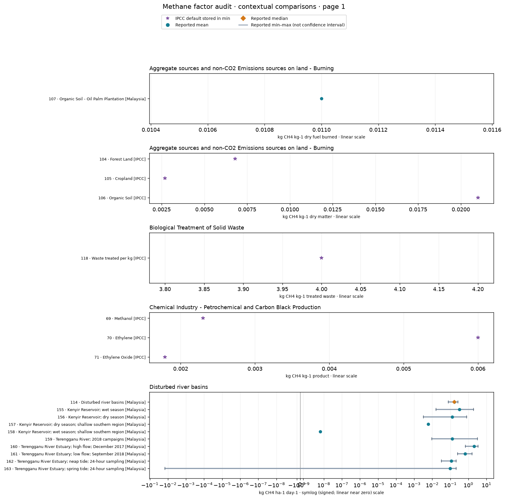
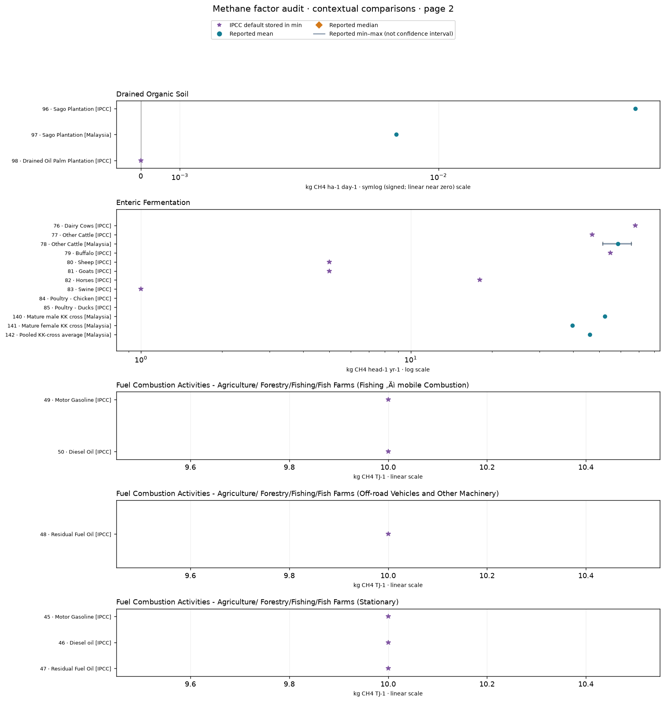
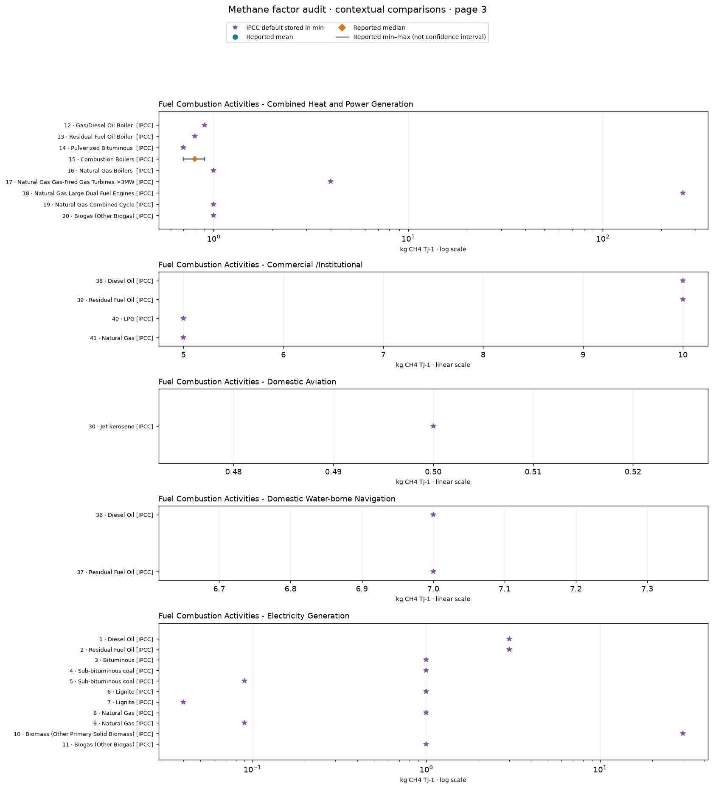
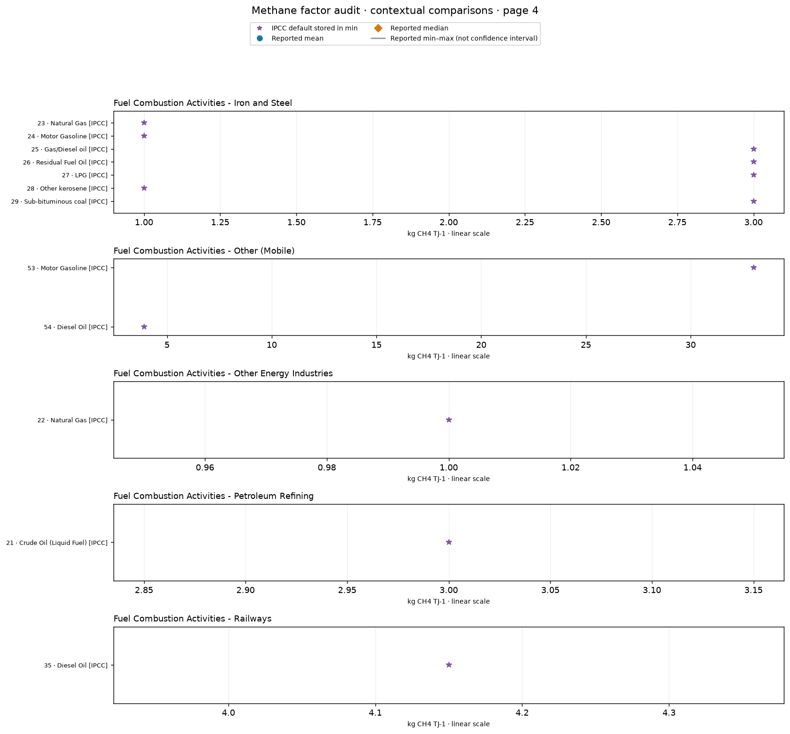
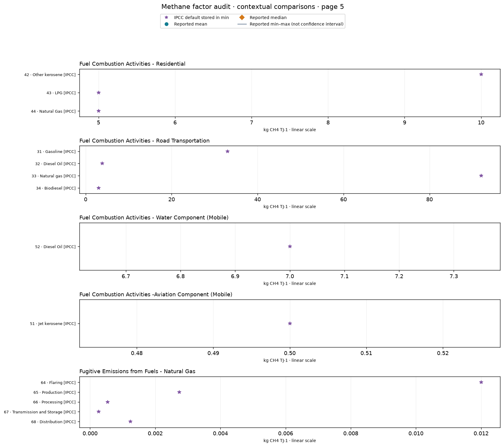
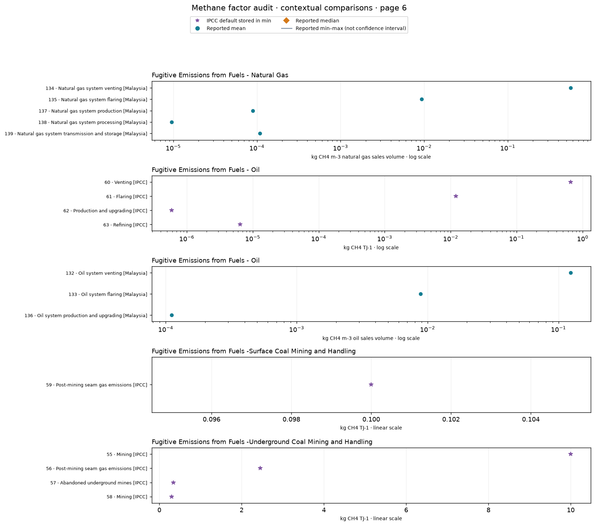
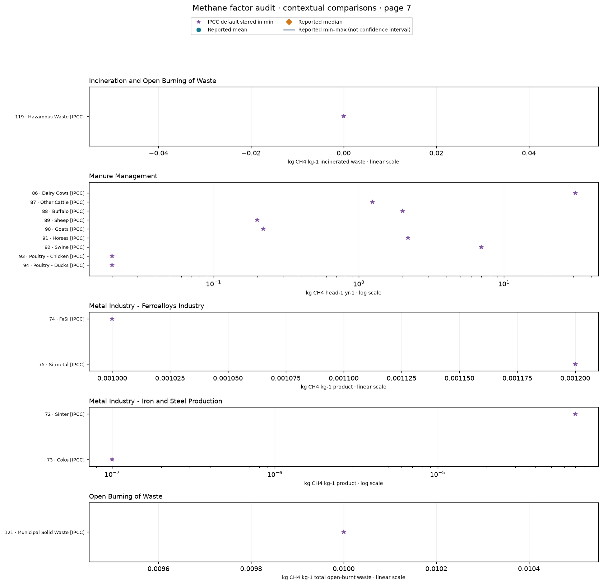
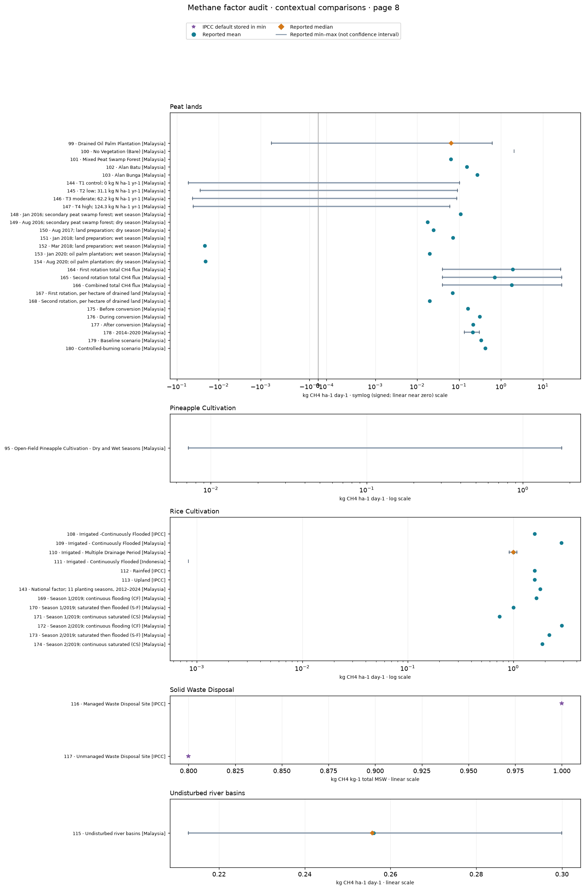
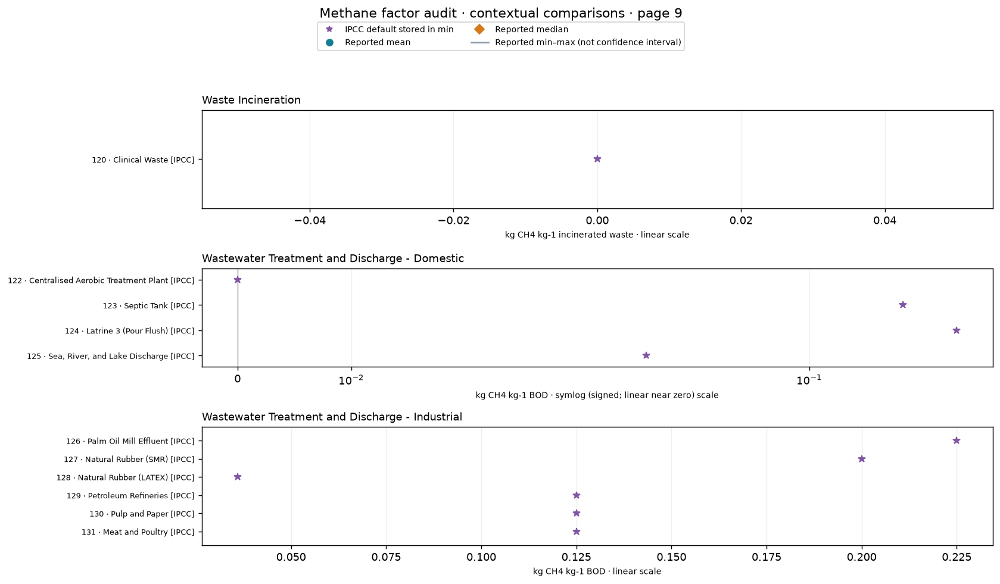

# Methane factor audit · 20261029-defaults-doi-report

Read-only audit of 180 database records across 43 category/unit groups. 0 records have numerical consistency prompts; 0 statistical peer signals; 12 broad magnitude contrasts. 220 stored statistics lack sufficient usable peer references. None of these results verifies or changes a factor.

Groups in the plots share category and unit only: species, process, country, methods and system boundaries can differ. A 100-fold category contrast is a navigation aid, not an implausibility threshold. Peer screening requires matching condition, country and statistic, at least six other rows and three independent source groups; source medians are weighted equally and overlapping DOI sources are excluded. Unknown source identities can remain dependent. Positive peer values use a log10 modified z score threshold of 3.5. Nonpositive values remain visible but are not scored. No universal physical limits are assumed. Missing signals do not demonstrate plausibility. Means, medians and endpoints are never substituted for each other. Owner-accepted IPCC/BUR defaults stored only in min are separately labeled default factors, with raw values preserved; they are not treated as measured minima. Ranges are reported bounds, not uncertainty intervals. Annual area fluxes are divided by 365; no other numeric conversions are applied. Scaling-factor modifiers are retained, not multiplied automatically. Oil/gas sales-volume, energy, BOD, product, dry matter and dry fuel bases remain separate. Previously closed sago conversion Q01 and paddy Q02 decisions remain closed; contextual plots do not reopen them.

[Full report with plots and source inventory](report.html) · [Machine-readable findings](audit.json)

- Fuel Combustion Activities - Electricity Generation: default_factor, records 7/10, 750× contextual span.
- Fuel Combustion Activities - Combined Heat and Power Generation: default_factor, records 14/18, 369× contextual span.
- Fugitive Emissions from Fuels - Oil: default_factor, records 62/60, 1,118,644× contextual span.
- Metal Industry - Iron and Steel Production: default_factor, records 73/72, 700× contextual span.
- Manure Management: default_factor, records 93/86, 1,550× contextual span.
- Peat lands: mean, records 149/164, 107× contextual span.
- Peat lands: max, records 147/165, 476× contextual span.
- Rice Cultivation: min, records 111/110, 1,097× contextual span.
- Disturbed river basins: mean, records 158/160, 329,949,239× contextual span.
- Disturbed river basins: min, records 156/160, 215× contextual span.
- Fugitive Emissions from Fuels - Oil: mean, records 136/132, 1,117× contextual span.
- Fugitive Emissions from Fuels - Natural Gas: mean, records 138/134, 59,205× contextual span.

Method: [NIST outlier guidance](https://itl.nist.gov/div898/handbook/eda/section3/eda35h.htm). No automatic corrections or verification changes.
